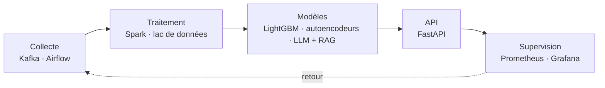
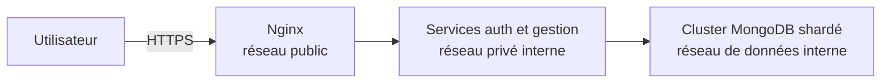

  
  
  

## En bref

Je construis des systèmes qui vont **de la collecte à la décision** : pipelines Kafka et Spark, modèles exposés par API, agents LLM avec RAG, le tout supervisé pour qu'on comprenne leur état d'un coup d'œil. J'aime les problèmes concrets qui doivent tenir en conditions réelles : la fraude, le crédit, le recrutement, l'industrie.

## De la donnée brute à la décision

## Projets phares

<table>
<tr>
<td width="50%" valign="top">

### [Détection de fraude en temps réel](https://github.com/Jean-Paul15/fraud-detection-paylink-africa)
La fraude pèse 0,15 % des transactions : un modèle naïf peut l'ignorer sans jamais se tromper. Quatre détecteurs de natures différentes, un méta-modèle, une validation par découpage temporel et un seuil guidé par le coût métier, exposés par une API de scoring.

   

</td>
<td width="50%" valign="top">

### [TalentFlow](https://github.com/Jean-Paul15/talentflow)
Des milliers d'offres d'emploi éparpillées sur le web, des CV à rapprocher : collecte, lac de données, recherche vectorielle, et une analyse des écarts de compétences expliquée par un LLM, sous supervision continue, jusqu'à l'application mobile.

    

</td>
</tr>
<tr>
<td width="50%" valign="top">

### [SOLIDA](https://github.com/Jean-Paul15/SOLIDA)
Noter un emprunteur qui n'a presque aucun papier. Un score fondé sur la trajectoire d'épargne, une couche solidaire pour le crédit de groupe, une décision proposée sous contrôle humain et consignée dans un journal qu'on ne peut pas réécrire.

   

</td>
<td width="50%" valign="top">

### [Alerte précoce de crédit, zone UMOA](https://github.com/Jean-Paul15/ews-credit-umoa)
Repérer les crédits qui vont basculer en défaut trois mois avant l'incident, sur un portefeuille que personne n'a le droit de publier : le secret bancaire impose de le fabriquer.

  

</td>
</tr>
<tr>
<td width="50%" valign="top">

### [Provisionnement IFRS 9 lisible](https://github.com/Jean-Paul15/credit-scoring)
Une probabilité de défaut que l'on peut lire, contrôler et défendre. Explainable Boosting Machine, contraintes de monotonie, scénarios macro, et une API qui renvoie la contribution exacte de chaque terme, sans boîte noire.

    

</td>
<td width="50%" valign="top">

### [Pipeline de streaming temps réel](https://github.com/Jean-Paul15/kafka-spark-pipeline)
Des événements e-commerce, taxi, météo et immobiliers qui circulent de Kafka vers Spark, puis vers PostgreSQL, HDFS, Redis, Grafana, Superset et Streamlit. Une pile entière, démarrée par Docker Compose.

   

</td>
</tr>
<tr>
<td width="50%" valign="top">

### [Base de données à la demande](https://github.com/Jean-Paul15/cloud-platform)
Un utilisateur s'authentifie, déclare un projet et réclame une instance MongoDB. Tout passe par une seule porte HTTPS, devant un cluster shardé isolé par trois réseaux Docker cloisonnés.

   

</td>
<td width="50%" valign="top">

### [EpiGraph](https://github.com/Jean-Paul15/epigraph)
Qui a contaminé qui, où, et quel hôpital a fini par en payer le prix ? Les chaînes d'infection suivies comme un graphe Neo4j, de la simulation des données jusqu'au tableau de bord.

  

</td>
</tr>
</table>

**Et aussi :** [`ceng`](https://github.com/Jean-Paul15/claude-eng-framework), un orchestrateur déterministe en TypeScript qui retire du LLM les décisions qu'il prend mal sur un chantier long · [`ds-finance-quant`](https://github.com/Jean-Paul15/ds-finance-quant), quatre chaînes de risque bancaire de bout en bout · [`mobile-money-fraud`](https://github.com/Jean-Paul15/mobile-money-fraud), un service qui note et explique chaque transaction.

## Sous le capot

Ce qui m'intéresse, ce sont les décisions d'ingénierie qui font qu'un système reste juste et tient en production.

<b>Une évaluation sans fuite temporelle</b>

Dans la détection de fraude, le jeu est coupé à une date fixe avant tout calcul de variables. Les moyennes par émetteur sont apprises sur l'entraînement puis réutilisées telles quelles sur le test, et la fenêtre glissante de 24 heures exclut la transaction courante. Un score qui triche en regardant l'avenir ne vaut rien en production.

<b>Un modèle de crédit qu'on peut défendre</b>

La probabilité de défaut est une Explainable Boosting Machine : l'API renvoie la contribution exacte de chaque terme, sans SHAP. Des contraintes de monotonie sont posées sur le retard, le ratio de service de la dette et la couverture par garantie. Les variables issues du graphe de transactions sont exclues des modèles éligibles, car elles ne sont pas point-in-time.

<b>Une plateforme cloisonnée par conception</b>

Trois réseaux Docker : seul Nginx touche le réseau public, les deux autres sont déclarés internes et n'ont aucune sortie directe vers l'extérieur. L'authentification fait tourner ses jetons : chaque rafraîchissement supprime l'ancien et en émet un nouveau. Derrière, un cluster MongoDB shardé démarré par script.

<b>Une décision de crédit sous contrôle humain</b>

Pour un emprunteur sans papiers, SOLIDA propose une décision avec les facteurs qui l'expliquent, mais c'est un humain qui tranche, et chaque décision est consignée dans un journal qu'on ne peut pas réécrire.

## Ma boîte à outils

**IA et données**

       

**Big data et backend**

    

**DevOps et cloud**

**Développement web et mobile**

 

**Analyse et visualisation**

   

## Certifications

**[Data Science Application](https://www.credly.com/badges/5887776b-4adc-4db7-bb95-f9b74d69e69b)** · WorldQuant University, août 2026  
Programme appliqué de huit projets en data science et machine learning : Random Forest et Gradient Boosting sur données déséquilibrées, segmentation K-means avec tableaux de bord Dash interactifs, tests A/B par chi-deux, modélisation de volatilité GARCH(1,1) en développement piloté par les tests. Des pipelines reproductibles, prêts à être déployés, et des résultats traduits en décisions métier.

**[Data Science Modeling](https://www.credly.com/badges/58558de1-639d-4dad-9934-7f457f8aaf22)** · WorldQuant University, août 2026  
Le cycle complet de la data science sur quatre projets pratiques (CSV, SQLite, MongoDB) : nettoyage et exploration de données tabulaires, analyse de corrélation, régression et classification supervisées avec régularisation Ridge et Lasso, modèles AR et ARMA, prévision de séries temporelles.

**[AWS Solutions Architect Associate SAA-C03](https://www.udemy.com/certificate/UC-5bca1f5c-cedd-4935-874a-c29a7696e51d/)** · Udemy, septembre 2026  
Préparation à l'examen AWS Certified Solutions Architect Associate : 43 heures de formation, 425 leçons, labs dans la console AWS, projets dans un compte AWS et 130 questions de révision, par un ancien architecte d'Amazon Web Services. Au programme, le Well-Architected Framework, IAM, EC2, le réseau, le stockage, les bases de données, l'analytique et les services d'IA, pour concevoir des architectures sécurisées, résilientes, performantes et maîtrisées en coût.

**[Data Science et Machine Learning avec Python](https://www.udemy.com/certificate/UC-c7343e22-1493-41be-a60f-bdba25c75ac3/)** · Udemy, décembre 2024  
Formation de 44,5 heures et 188 leçons, conçue avec Jose Portilla de Pierian Training : NumPy et Pandas pour manipuler des données réelles, visualisation avec Matplotlib et Seaborn, puis modèles de régression et de classification avec Scikit-Learn (régression linéaire et logistique, KNN, SVM, arbres de décision, Random Forests), préparation des variables, validation croisée et Grid Search. Des études de cas réels, à moitié théorie et à moitié code.

## Activité

<picture>
  <source media="(prefers-color-scheme: dark)" srcset="https://raw.githubusercontent.com/Jean-Paul15/Jean-Paul15/output/github-snake-dark.svg">
  
</picture>

## En ce moment

Je construis **[Steko](https://steko.app)**, une application mobile de pilotage de vie dotée d'un agent d'IA : Flutter, Supabase et un moteur d'agent en Edge Functions. Elle est en test fermé sur Google Play. Je pousse aussi mes pipelines vers la supervision et l'évaluation des réponses d'IA, parce qu'une synthèse n'est utile que si elle est juste.

## Me contacter

Le plus simple : [LinkedIn](https://www.linkedin.com/in/jean-paul-adogli-7203112b9) ou par [e-mail](mailto:adoglijeanpaul@gmail.com).

  

